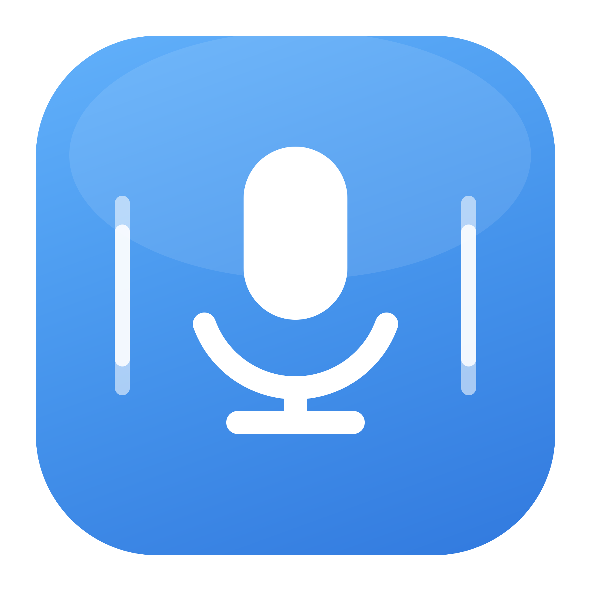

# Pitchi — diktiranje na srpskom i engleskom (macOS)

Pitchi je macOS aplikacija za dikiranje: držiš `Fn`, izgovoriš rečenicu, pusti
— tekst se prepiše **lokalno** (whisper.cpp) i zalepi u aplikaciju u kojoj
pišeš. Jezik se prepoznaje automatski, pa srpski i engleski mogu da se smenjuju
bez podešavanja. Snimak ne napušta Mac.

Aplikacija ima prozor sa stanjem, istorijom, rečnikom i podešavanjima; radi i
iz menu bara. Model se učitava samo tokom diktiranja i oslobađa posle 5 minuta,
pa i 8 GB Mac ostaje upotrebljiv.



## Šta radi

- **Fn kao prečica** — drži i govori, pusti kada završiš; radi i van Pitchi-ja.
- **Automatsko lepljenje** — pošalje `Cmd+V` u aplikaciju u kojoj si bio; ako
  dozvola nije data, tekst čeka u klipbordu.
- **Srpski i engleski** — jezik se prepoznaje automatski; srpski izlaz ide u
  latinicu.
- **Rečnik** — imena i pojmovi koje model pogrešno piše.
- **Istorija** — zadnjih 200 prepisa, pretraga i kopiranje.
- **Opciono DeepSeek doterivanje** — popravi interpunkciju i imena; isključeno
  po defaultu, šalje se samo tekst, nikada zvuk.

## Instalacija

Potrebni su Command Line Tools (`xcode-select --install`), `cmake`
(`brew install cmake`) i `git` — samo za prvo građenje whisper.cpp-a.

```bash
bash app/instaliraj.sh            # prvi put
bash app/instaliraj.sh --prepisi  # nova verzija (stara ide u .bak)
```

Skripta napravi `Pitchi.app`, potpiše ga lokalnim sertifikatom (ako postoji) i
smesti u `/Applications`.

### Prvo pokretanje

1. Otvori Pitchi — prozor se pojavi sam, ikona ostaje u menu baru.
2. Daj tri dozvole iz prozora:
   - **Mikrofon** — da čuje govor.
   - **Nadzor unosa** — da prepozna `Fn` i van Pitchi-ja. Posle ove dozvole
     zatvori i ponovo otvori aplikaciju.
   - **Pristupačnost** — da pošalje `Cmd+V` posle prepisa.
3. Ako model nije tu, klikni **Preuzmi model (1 GB)**.

Ako `Fn` otvara emoji birač: Podešavanja → Tastatura → „Pritisni 🌐 key za” →
**Ne radi ništa**.

## Model i memorija

Podrazumevani model je `large-v3 q5_0` (1 GB) — najbolji kompromis za 8 GB.
Model se čuva u:

```
~/Library/Application Support/Pitchi/models/ggml-large-v3-q5_0.bin
```

Ako postoji stari Pichi model, Pitchi ga preuzima bez ponovnog skidanja.
Dok je model učitan, aplikacija drži ~1,4 GB; posle 5 minuta mirovanja se
oslobađa. Prvi prepis posle novog builda je sporiji jer se kompajliraju Metal
šejderi; sledeći su ~3 s za kraću rečenicu.

## Privatnost

- Snimak se ne čuva i ne šalje nigde.
- Istorija i rečnik su lokalni fajlovi u `~/Library/Application Support/Pitchi/`.
- DeepSeek je opcion i šalje samo gotov tekst, nikada zvuk.

## Razvoj

```
app/
  src/                 Swift izvori (AppKit + SwiftUI)
  Info.plist           bundle, dozvole, LSUIElement
  build.sh             građenje + potpisivanje
  pripremi-whisper.sh  jednokratno građenje statičkog whisper.cpp-a
  instaliraj.sh        build + /Applications
  vendor/              whisper.cpp biblioteke (ne ide u git)
pitchi.js, lib/, test/ stariji CLI (Node, bez paketa)
```

```bash
bash app/build.sh
open app/build/Pitchi.app
```

Whisper je **statički** ugrađen (Metal + BLAS), pa aplikacija ne zavisi od
Homebrew-a na ciljnom Macu. Skrivene razvojne opcije: `--slika` (nacrta tabove
u PNG), `--test-whisper` (prepiše `/tmp/sr.wav` kroz isti kod).

## Stariji CLI

`pitchi.js` je prva verzija (Node 22.5+, ffmpeg + whisper-cli) i još radi:

```bash
node pitchi.js stanje
node pitchi.js diktat
npm test
```

## Zahvalnost

- [whisper.cpp](https://github.com/ggml-org/whisper.cpp) (MIT)
- OpenAI Whisper model `large-v3` (MIT), q5_0 kvantizacija
