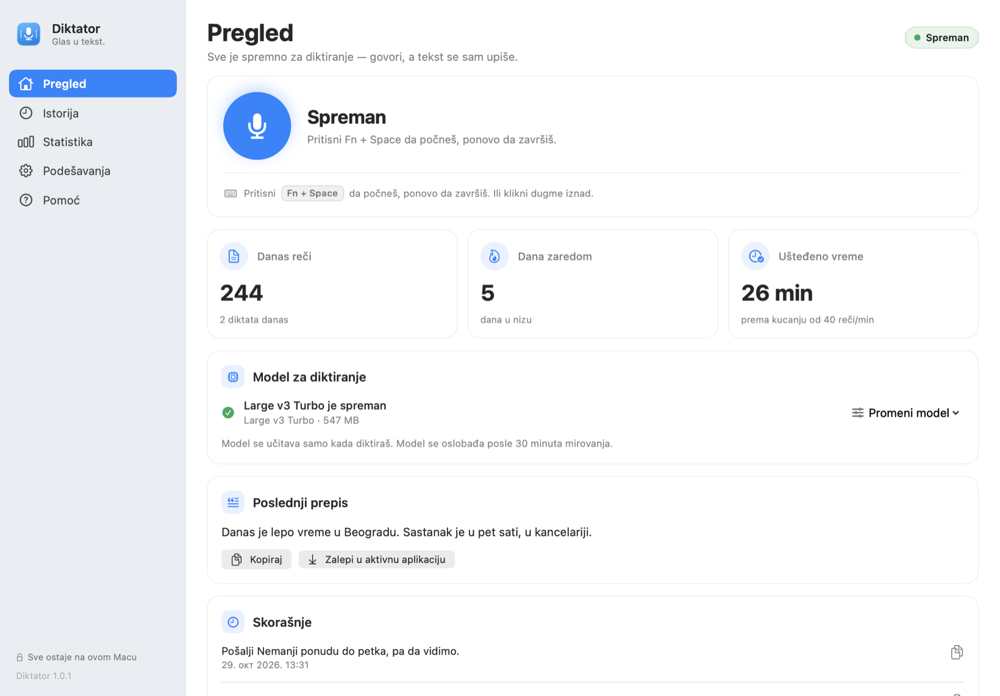
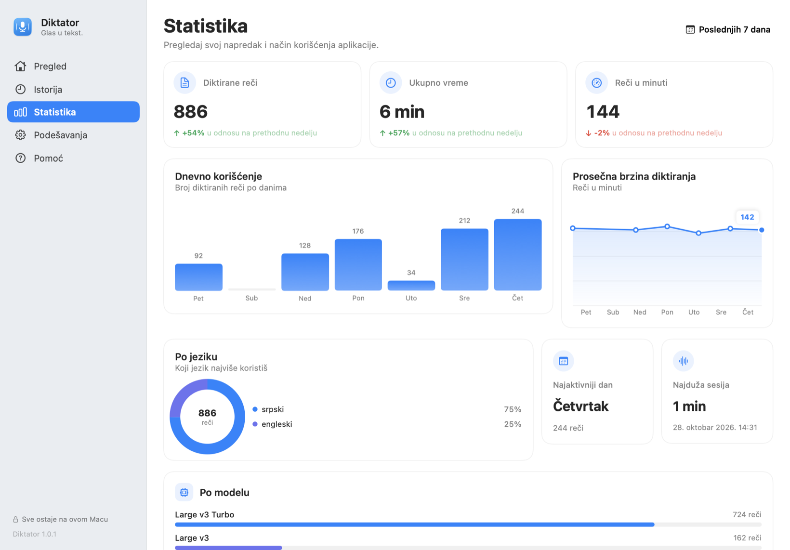
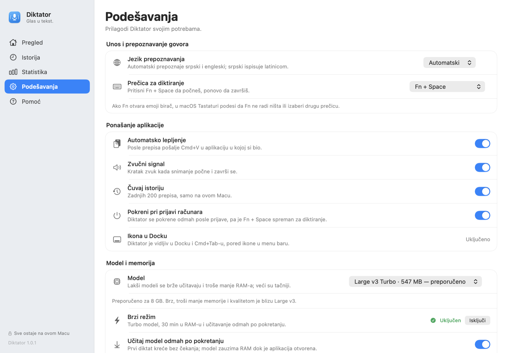
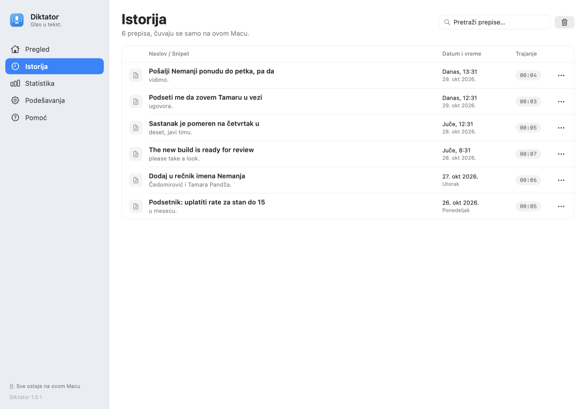
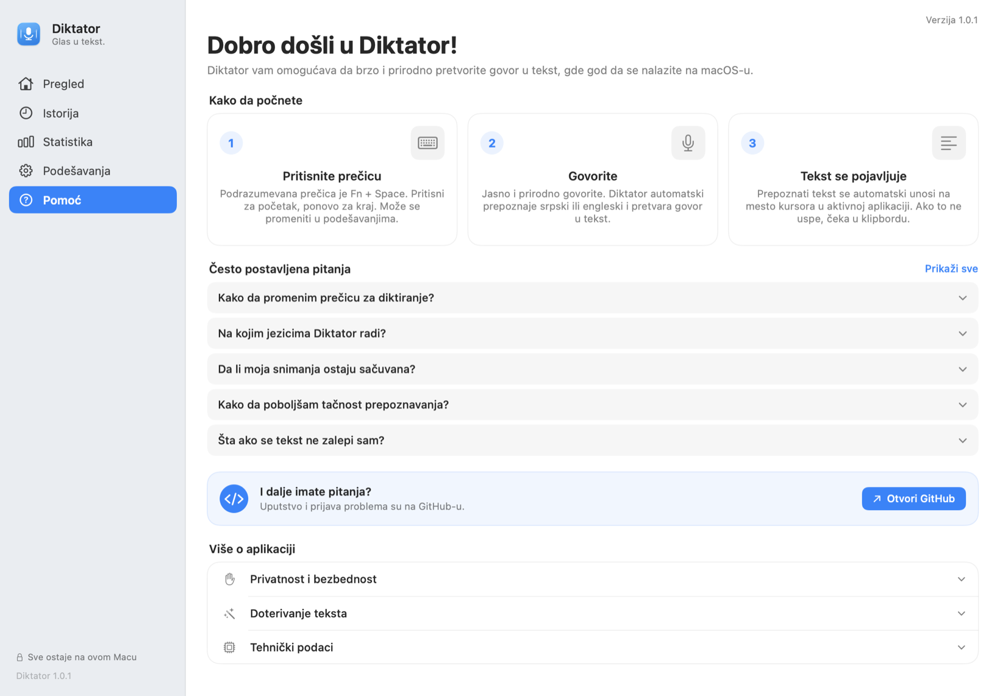
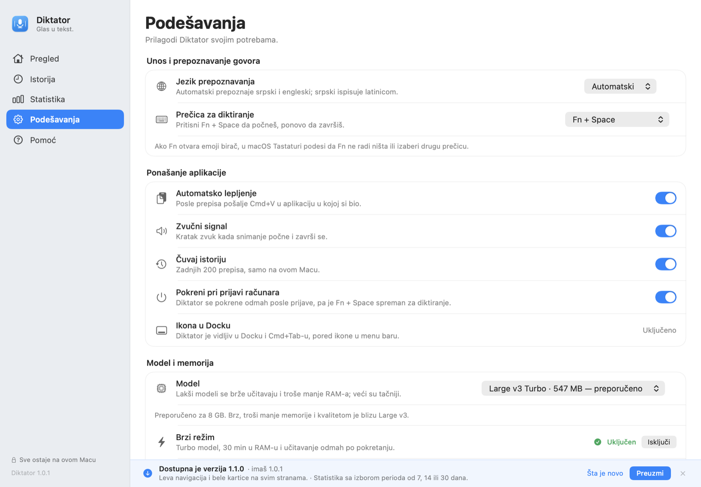

# Diktator — diktiranje na srpskom i engleskom (macOS)

Diktator je macOS aplikacija za diktiranje: držiš izabranu prečicu (podrazumevano
`Fn`), izgovoriš rečenicu, pusti — tekst se prepiše **lokalno** (whisper.cpp) i
zalepi u aplikaciju u kojoj pišeš. Može i kao prekidač: pritisni `Fn + Space` za
početak, ponovo za kraj. Jezik se prepoznaje automatski, pa srpski i engleski
mogu da se smenjuju bez podešavanja. Snimak ne napušta Mac.

Aplikacija ima prozor sa levom navigacijom (Pregled, Istorija, Statistika,
Podešavanja, Pomoć), ikonu u Docku i u menu baru. Model se učitava samo tokom
diktiranja i oslobađa posle izabranog vremena mirovanja (podrazumevano 5
minuta), pa i 8 GB Mac ostaje upotrebljiv. Koji model se koristi biraš sam, a
lakši modeli se preuzimaju direktno iz aplikacije.

| Početak | Statistika | Podešavanja |
|---|---|---|
|  |  |  |

| Istorija | Pomoć | Novo izdanje |
|---|---|---|
|  |  |  |

## Šta radi

- **Izbor prečice** — podrazumevano `Fn` (drži i govori); možeš izabrati i
  `Fn + Space` kao prekidač (pritisni za početak, ponovo za kraj), desni
  `Option`, `Command`, `Control` ili `Shift`, ili `F13`–`F19`. Radi i van
  Diktatora.
- **Automatsko lepljenje** — pošalje `Cmd+V` u aplikaciju u kojoj si bio; ako
  dozvola nije data, tekst čeka u klipbordu.
- **Srpski i engleski** — jezik se prepoznaje automatski; srpski izlaz ide u
  latinicu.
- **Rečnik** — imena i pojmovi koje model pogrešno piše.
- **Najduži snimak 5 minuta** — snimanje se samo završi na pet minuta i tekst se
  prepiše; tako memorija ne raste neograničeno pri dugom držanju prečice.
- **Istorija** — zadnjih 200 prepisa, pretraga i kopiranje.
- **Statistika** — reči, trajanje, brzina govora i ušteđeno vreme za poslednjih
  7, 14 ili 30 dana, uz poređenje sa prethodnim periodom; dnevni stubovi, linija
  brzine, podela po jeziku i modelu, najaktivniji dan i najduža sesija. Računa se
  samo iz brojeva o diktatima, nikada iz teksta.
- **Izbor modela** — Tiny, Base, Small, Large v3 Turbo i Large v3; lakši modeli
  se preuzimaju iz same aplikacije, bez terminala.
- **Brzi režim** — Turbo model, 30 minuta u RAM-u i učitavanje odmah po
  pokretanju; model se automatski pušta na pritisak memorije, san ekrana i u
  Low Power Mode, pa brzina ne guši Mac.
- **Oslobađanje memorije** — biraš da se model oslobodi odmah, posle 1, 5, 15
  ili 30 minuta, ili nikad; „Odmah“ najviše štedi RAM, a „Nikad“ ubrzava sledeći
  prepis.
- **Pokretanje pri prijavi** — opciono u Podešavanjima, preko macOS Login Items.
- **Dock i menu bar** — ikonica je vidljiva na oba mesta; klik na Dock ponovo
  otvara prozor.
- **Ažuriranja** — jednom dnevno proveri GitHub; kada postoji novije izdanje,
  prikaže obaveštenje i traku na dnu prozora sa dugmetom za preuzimanje.
- **Opciono doterivanje teksta** — izaberi DeepSeek, OpenAI, Anthropic Claude,
  Google Gemini, lokalni Ollama ili drugi OpenAI-kompatibilni servis; popravlja
  interpunkciju i imena. Isključeno po defaultu, šalje se samo tekst, nikada zvuk.

## Instalacija

### Gotova aplikacija

1. Preuzmi najnoviji `Diktator-…-macOS-arm64.zip` sa
   [Releases](https://github.com/cedomirovic/pitchi/releases/latest).
2. Otpakuj i prevuci `Diktator.app` u `/Applications`.
3. Aplikacija nije notarizovana, pa je macOS pri prvom pokretanju blokira. Ako
   se to desi, vidi **Ako macOS blokira aplikaciju** ispod — sve ide kroz
   System Settings, bez terminala.

Potreban je Apple Silicon i macOS 13 ili noviji.

### Ako macOS blokira aplikaciju

Kada se aplikacija ne otvori zato što nije notarizovana („Apple could not
verify…“), otključaj je kroz System Settings:

1. U prozoru koji iskoči klikni **Done**. Ne klikći „Move to Bin“.
2. Otvori **System Settings** → **Privacy & Security**.
3. Skroluj skroz dole do sekcije **Security**. Tamo piše nešto kao
   „Diktator“ was blocked to protect your Mac, a pored je dugme **Open Anyway**.
   Klikni ga.
4. Potvrdi lozinkom ili Touch ID-jem.
5. Ponovo pokreni Diktator. Kada iskoči isti prozor, izaberi **Open Anyway**.

Ako dugme **Open Anyway** ne postoji, proveri da je `Diktator.app` u
`/Applications` (ne u Downloads) i pokreni ga jednom iz tog foldera.

Napredna alternativa, ako baš želiš terminal:

```bash
xattr -dr com.apple.quarantine /Applications/Diktator.app
```

### Iz izvornog koda

Potrebni su Command Line Tools (`xcode-select --install`), `cmake`
(`brew install cmake`) i `git` — samo za prvo građenje whisper.cpp-a.

```bash
git clone https://github.com/cedomirovic/pitchi.git
cd pitchi
bash app/instaliraj.sh            # prvi put
bash app/instaliraj.sh --prepisi  # nova verzija (stara ide u .bak)
```

Prvo građenje traje **5–10 minuta** jer se whisper.cpp i Metal biblioteke
kompajliraju jednokratno. Skripta napravi `Diktator.app`, potpiše ga lokalno
(ad-hoc ako nema razvojnog sertifikata) i smesti u `/Applications`.

### Prvo pokretanje

1. Otvori Diktator — prozor se pojavi sam, a ikona je u Docku i u menu baru.
2. Daj tri dozvole iz prozora:
   - **Mikrofon** — da čuje govor.
   - **Nadzor unosa** — da prepozna izabranu prečicu i van Diktatora. Posle ove
     dozvole zatvori i ponovo otvori aplikaciju.
   - **Pristupačnost** — da pošalje `Cmd+V` posle prepisa.
3. U Podešavanjima → **Model** izaberi model. Preporučeni Large v3 Turbo ima
   547 MB; ako želiš najmanji, izaberi Tiny (74 MB).

### Prečica

Podrazumevano se drži `Fn`. U **Podešavanjima → Diktiranje → Prečica za
diktiranje** možeš izabrati:

- `Fn` — drži i govori,
- `Fn + Space` — pritisni za početak, ponovo za kraj (prekidač),
- desni `Option`, `Command`, `Control` ili `Shift` — levi tasteri ostaju
  slobodni za normalno kucanje,
- `F13`–`F19`.

Promena važi odmah, bez ponovnog pokretanja aplikacije. Ako `Fn` ili
`Fn + Space` otvara emoji birač, izaberi drugu prečicu ili u macOS-u otvori
Podešavanja → Tastatura → „Pritisni 🌐 key za” → **Ne radi ništa**.

## Model i memorija

Preporučeni model je **Large v3 Turbo q5_0** (547 MB): brz je, troši manje
memorije i kvalitetom je blizu Large v3. U Podešavanjima → **Model** možeš
izabrati i drugi model; svi se preuzimaju jednokratno sa Hugging Face-a.

| Model | Veličina | Kada ga izabrati |
|---|---|---|
| Tiny | 74 MB | najbrži, za probe; češće greši imena |
| Base | 141 MB | mali i brz, osnovni kvalitet |
| Small | 465 MB | kada je malo RAM-a, solidan kvalitet |
| Large v3 Turbo | 547 MB | **preporučeno za 8 GB** |
| Large v3 | 1,0 GB | najbolji kvalitet, traži više RAM-a |

Modeli se čuvaju u:

```
~/Library/Application Support/Diktator/models/
```

Dok je model učitan, aplikacija drži ~0,2–1,4 GB, zavisno od izbora. U
Podešavanjima → Model → **Oslobodi memoriju posle** biraš da se model oslobodi
odmah, posle 1, 5, 15 ili 30 minuta mirovanja, ili nikad; podrazumevano je 5
minuta. Model se oslobađa i kada prepis ne uspe ili snimak bude tišina, a ne
samo posle uspešnog prepisa. Snimak je ograničen na 5 minuta da ne bi
neograničeno rastao u memoriji. Ako želiš još manje RAM-a, u Podešavanjima →
Model → **Režim prepisa** izaberi **Manje memorije**: greedy dekodiranje troši
oko 400 MB manje od beam search-a i malo je brže, ali na težem snimku može dati
sitno drugačiji tekst. Prvi prepis posle novog builda je sporiji jer se
kompajliraju Metal šejderi; sledeći su nekoliko sekundi za kraću rečenicu
(uključujući detekciju jezika).

**Brzi režim** (Podešavanja → Model) bira Turbo, drži ga 30 minuta i učitava ga
odmah po pokretanju, pa prvi diktat ne čeka učitavanje. Model se ipak pušta čim
macOS javi pritisak na RAM, kada se ekran zaključa ili zaspi i u Low Power Mode —
brzina ne znači da Mac ostaje bez memorije. Izmereno na ovom Macu sa snimkom od
4,3 s: Large v3 ~3,7 s i ~1,9 GB, Turbo ~2,9 s i ~0,9 GB; učitavanje ~0,7 s
prema ~0,2 s.

## Rečnik

Rečnik je spisak imena, prezimena, firmi, proizvoda i stručnih pojmova koje
Whisper pogrešno piše. Model ga dobija kao **nagoveštaj**, ne kao tekst koji
izgovara.

- **Jedan pojam po redu ili odvojeno zarezom** — oba oblika rade isto;
  latinicom i sa dijakriticima onako kako želiš da izađe („Čedomirović“, ne
  „Cedomirovic“).
- **Najvažnije na početak** — u prompt staje 600 znakova, a sve posle toga se
  ne šalje modelu. Aplikacija prikazuje koliko je znakova zauzeto i upozori
  kada se pređe limit.
- **Obične reči ne pomažu.** Whisper ih već zna, a spisak tipa „da, je, ne, se“
  samo zauzme prostor i istisne imena. Zato se u rečnik stavljaju samo pojmovi
  koje model stvarno pogrešno piše.
- **Whisper ne prima rečenice.** Ako u rečnik staviš rečenicu, ona troši
  budžet, a ne pomaže.

Provereno na snimku od 11,6 s (Turbo): bez rečnika model napiše „Swift UII“,
„Visper CPP“ i „Tamara Pandva“; sa rečnikom „SwiftUI“, „whisper.cpp“ i
„Tamara Pandža“. Isti snimak sa 100 najčešćih srpskih reči u promptu daje iste
greške i izgubi velika slova — zato najčešće reči nisu korisna baza.

## Doterivanje teksta (opciono)

Whisper ponekad pogreši interpunkciju ili ime. Ako uključiš doterivanje, Diktator
pošalje **samo gotov tekst** izabranom servisu i vrati ispravljenu verziju.
Snimak se nikada ne šalje. Opcija je isključena po defaultu.

U **Podešavanjima → Doterivanje teksta**:

1. Uključi „Popravi interpunkciju i imena“.
2. Izaberi servis.
3. Unesi API ključ (osim za Ollama; kod drugih servisa samo ako ga traže) i
   klikni **Sačuvaj**.
4. Po potrebi promeni **Model**; za „Drugi OpenAI-kompatibilni“ unesi i adresu.
5. Klikni **Test veze**. Ako prođe, diktat će automatski doterivati tekst.

| Servis | Šta treba | Podrazumevani model |
|---|---|---|
| DeepSeek | API ključ sa [platform.deepseek.com](https://platform.deepseek.com/api_keys) | `deepseek-chat` |
| OpenAI / ChatGPT | API ključ sa [platform.openai.com](https://platform.openai.com/api-keys) | `gpt-4o-mini` |
| Anthropic Claude | API ključ sa [console.anthropic.com](https://console.anthropic.com/settings/keys) | `claude-haiku-5-5` |
| Google Gemini | API ključ sa [aistudio.google.com](https://aistudio.google.com/app/apikey) | `gemini-3.5-flash-lite` |
| Ollama | Instaliran Ollama i preuzet model; bez ključa | `llama3.2` |
| Drugi OpenAI-kompatibilni | Adresa i model; ključ ako servis traži | `local-model` |

### DeepSeek

Napravi ključ na [platform.deepseek.com](https://platform.deepseek.com/api_keys)
i nalepi ga u Diktator. Postojeći DeepSeek ključ iz starije verzije se automatski
koristi. Model `deepseek-chat` je dovoljan za lektorisanje.

### OpenAI / ChatGPT

Potreban je **API ključ** sa [platform.openai.com](https://platform.openai.com/api-keys).
ChatGPT Plus pretplata nije isto što i API i ne uključuje pozive iz drugih
aplikacija. API se posebno naplaćuje; `gpt-4o-mini` je jeftin izbor za kratke
prepise.

### Anthropic Claude

Napravi ključ na [console.anthropic.com](https://console.anthropic.com/settings/keys).
Diktator koristi Claude Messages API i podrazumevano model `claude-haiku-5-5`.

**Claude Code nije API.** To je CLI alat za rad u terminalu i Diktator ga ne
poziva. Ako želiš Claude za doterivanje, izaberi „Anthropic Claude“ i napravi
Anthropic API ključ.

### Google Gemini

Napravi ključ u [Google AI Studio](https://aistudio.google.com/app/apikey) i
nalepi ga u Diktator. Podrazumevani model je `gemini-3.5-flash-lite`; ako želiš
noviji ili drugi model, upiši njegov tačan naziv u polje **Model**. Gemini
Advanced pretplata nije dovoljna — potreban je API ključ iz AI Studio-a.

### Ollama (lokalno)

Instaliraj [Ollama](https://ollama.com/download), pa u terminalu pokreni:

```bash
ollama pull llama3.2
```

Diktator koristi `http://localhost:11434/api/chat`, bez ključa. Tekst tada ne
napušta Mac. Ako imaš drugi model, upiši njegov tačan naziv u polje **Model**
(na primer `qwen2.5:7b`).

### Drugi OpenAI-kompatibilni servis

Isti obrazac rade OpenRouter, Groq, LM Studio, vLLM i slični servisi. Unesi
adresu koja se završava sa `/chat/completions`, tačan naziv modela i ključ ako
ga servis traži. Iz bezbednosnih razloga adresa mora da koristi `https://`;
`http://` je dozvoljen samo za `localhost` (LM Studio, Ollama i drugi lokalni
servisi). Primeri:

- OpenRouter: `https://openrouter.ai/api/v1/chat/completions`
- Groq: `https://api.groq.com/openai/v1/chat/completions`
- LM Studio: `http://localhost:1234/v1/chat/completions`

Ako **Test veze** prijavi HTTP 401, ključ nije ispravan. HTTP 404 obično znači
pogrešnu adresu ili naziv modela. Ključevi se čuvaju u macOS Keychain-u, po
servisu odvojeno; ne upisuju se u istoriju ni u fajl sa podešavanjima.

## Ažuriranja

Diktator pri pokretanju i najviše jednom dnevno pita GitHub za najnovije izdanje
(`api.github.com/repos/cedomirovic/pitchi/releases/latest`). Ako je verzija
novija od instalirane:

- prikaže sistemsko obaveštenje (prvi put traži dozvolu za obaveštenja),
- u obaveštenju, traci i Podešavanjima napiše **šta je novo** — stavke iz opisa
  izdanja na GitHub-u, bez markdown oznaka,
- prikaže traku u prozoru sa dugmetom **Preuzmi**,
- u menu baru stavi **Ažuriranje X…**.

Aplikacija se ne menja sama. **Preuzmi** otvara zip paket u browseru, a
**Stranica izdanja** vodi na GitHub. Posle preuzimanja zameni `Diktator.app` u
`/Applications` (stara kopija može u `.bak`).

Proveru možeš isključiti u Podešavanjima → **Ažuriranja**, a ručno je pokrenuti
dugmetom **Proveri ažuriranja** ili iz menija u menu baru. Preskočena verzija
se ne nudi ponovo dok ne izađe novija.

## Privatnost i bezbednost

- Snimak se ne čuva i ne šalje nigde.
- Istorija i rečnik su lokalni fajlovi u `~/Library/Application Support/Diktator/`.
  Folder je dostupan samo korisniku (0700), a fajlovi istorije i rečnika samo
  korisniku (0600). I stariji CLI upisuje snimke i prepise sa dozvolama 0600.
- Statistika (`statistika.json`) čuva samo brojeve: datum, broj reči, trajanje,
  jezik i model. Tekst diktata se u statistiku ne upisuje, a fajl ima dozvole
  0600. Brisanjem statistike brišu se samo ti brojevi — istorija i rečnik ostaju.
- Doterivanje je opciono i šalje samo gotov tekst, nikada zvuk. Kod Ollama
  servisa i tekst ostaje na Macu; kod ostalih ide izabranom provajderu.
- API ključevi su u macOS Keychain-u, odvojeno po servisu. Dostupni su samo dok
  je Mac otključan i samo na ovom uređaju; ne sinhronizuju se preko iCloud-a.
- Adresa za doterivanje mora da koristi `https://`; `http://` je dozvoljen samo
  za `localhost`, da ključ i tekst ne bi išli nešifrovani preko mreže.
- Modeli se preuzimaju isključivo preko HTTPS-a sa Hugging Face-a, a veličina
  fajla se proverava pre nego što model postane dostupan.
- Provera ažuriranja šalje samo običan HTTPS zahtev GitHub-u za javni spisak
  izdanja. Aplikacija otvara samo HTTPS adrese sa GitHub-a. Ne šalju se tekst,
  snimak ni podaci o računaru.
- Preuzimaj aplikaciju samo sa zvanične GitHub stranice izdanja. Paket nije
  notarizovan, pa macOS pri prvom pokretanju traži potvrdu (desni klik → Open).

## Razvoj

```
app/
  src/                 Swift izvori (AppKit + SwiftUI)
  Info.plist           bundle, dozvole, Dock i menu bar
  build.sh             građenje + potpisivanje
  pripremi-whisper.sh  jednokratno građenje statičkog whisper.cpp-a
  instaliraj.sh        build + /Applications
  vendor/              whisper.cpp biblioteke (ne ide u git)
diktator.js, lib/, test/ stariji CLI (Node, bez paketa)
```

```bash
bash app/build.sh
open app/build/Diktator.app
```

Whisper je **statički** ugrađen (Metal + BLAS), pa aplikacija ne zavisi od
Homebrew-a na ciljnom Macu. Skrivene razvojne opcije: `--slika` (nacrta tabove
u PNG), `--test-whisper` (prepiše `/tmp/sr.wav` kroz isti kod), `--dozvole`
(ispiše stvarne macOS dozvole) i `--prijava` (uključi pokretanje pri prijavi).
Za proveru ažuriranja bez objave: `DIKTATOR_AZURIRANJE_API` menja GitHub
adresu, a `DIKTATOR_SLIKA_AZURIRANJE=1` ubacuje lažno izdanje u `--slika`.

## Stariji CLI

`diktator.js` je prva verzija (Node 22.5+, ffmpeg + whisper-cli) i još radi:

```bash
node diktator.js stanje
node diktator.js diktat
npm test
```

## Zahvalnost

- [Pichi](https://github.com/ndjerma/pichi-release) — inspiracija za Diktator.
- [whisper.cpp](https://github.com/ggml-org/whisper.cpp) (MIT)
- OpenAI Whisper modeli Tiny, Base, Small, Large v3 Turbo i Large v3 (MIT)
